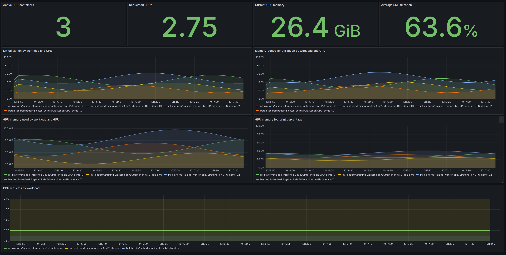

# GPU Process Exporter

GPU Process Exporter is a Kubex Prometheus exporter for Kubernetes nodes with NVIDIA GPUs. It reads per-process GPU data through NVIDIA Management Library, maps host PIDs back to Kubernetes pods and containers, and exposes container-labelled metrics.

The project is owned by Evenkeel Inc. d/b/a Kubex and licensed under Apache License 2.0. The first supported open-source release is `v1.1.0`. Earlier image tags are pre-open-source builds and are supported by Kubex but do not have their source open.



## When to use it

Use this exporter when node-level or device-level GPU metrics are not enough and you need per-container attribution. It is designed for Linux Kubernetes nodes running NVIDIA GPUs and a container runtime that exposes host process and container metadata to privileged DaemonSet pods.

DCGM Exporter is still useful for device health and broad GPU telemetry. This exporter focuses on the process-to-container mapping path.

## Assumptions

- NVIDIA GPU nodes with NVML available on the host.
- Linux nodes.
- Kubernetes pods and containers visible through the host `/proc` tree.
- A deployment model that can mount host paths and run with the permissions needed to inspect host processes.
- Container IDs that can be resolved from cgroup data under the mounted host `/proc` tree.

## Helm

Helm is the easiest way to use this exporter. [Get the chart here](https://github.com/densify-dev/helm-charts/tree/master/charts/gpu-process-exporter).

## Configuration

| Variable | Default | Required | Description |
| --- | --- | --- | --- |
| `NODE_NAME` | none | yes | Kubernetes node name to use in metric labels and pod lookups. |
| `HOST_PROC_MOUNT_POINT` | `/host/proc` | no | Host `/proc` mount inside the exporter container. |
| `DRIVER_POLL_INTERVAL` | `1s` | no | How often the exporter polls NVML. |
| `SCRAPE_INTERVAL` | `60s` | no | Exporter's expected matching interval for Prometheus scrapes. It does not configure Prometheus and must be a multiple of `DRIVER_POLL_INTERVAL`. |
| `EXPORTER_ENDPOINT` | `/metrics` | no | HTTP path for Prometheus metrics. |
| `EXPORTER_PORT` | `9494` | no | Metrics port. Must be between 1024 and 65535. |
| `NVML_SEARCH_PATH` | auto-detect | no | Host path containing `libnvidia-ml.so` if auto-detection does not find it. |

## Metrics

Container metrics (`kubex_gpu_container_*`) use Kubernetes container labels. Per-device metrics also include GPU UUID and model. The build information metric uses its own labels, described below.

Container labels:

- `node`
- `namespace`
- `pod`
- `container`
- `container_id`
- `gpu_allocation_type`

Per-device labels add:

- `gpu_uuid`
- `gpu_model`

Exported metrics:

| Metric | Type | Description |
| --- | --- | --- |
| `kubex_gpu_container_requests` | gauge | Requested GPUs or GPU fractions. |
| `kubex_gpu_container_limits` | gauge | GPU limits or GPU fractions. |
| `kubex_gpu_container_memory_bytes` | gauge | GPU memory used by the container on a GPU. |
| `kubex_gpu_container_memory_total_bytes` | gauge | Total memory for the GPU. |
| `kubex_gpu_container_memory_footprint_percent` | gauge | Container memory use as a percent of GPU memory. |
| `kubex_gpu_container_sm_utilization_percent_seconds_total` | counter | Accumulated SM utilization. |
| `kubex_gpu_container_memory_utilization_percent_seconds_total` | counter | Accumulated memory r/w activity utilization. |
| `kubex_gpu_container_enc_utilization_percent_seconds_total` | counter | Accumulated encoder utilization. |
| `kubex_gpu_container_dec_utilization_percent_seconds_total` | counter | Accumulated decoder utilization. |
| `kubex_gpu_container_ofa_utilization_percent_seconds_total` | counter | Accumulated OFA utilization. |
| `kubex_gpu_container_jpg_utilization_percent_seconds_total` | counter | Accumulated JPG utilization. |
| `kubex_gpu_container_protected_memory_bytes` | gauge | Protected memory reported by NVML. |
| `kubex_gpu_container_accounting_gpu_percent` | gauge | NVML accounting GPU utilization. |
| `kubex_gpu_container_accounting_memory_percent` | gauge | NVML accounting memory utilization. |
| `kubex_gpu_container_accounting_max_memory_bytes` | gauge | Maximum memory from NVML accounting. |
| `kubex_gpu_container_accounting_time_us` | gauge | Accounting runtime in microseconds. |
| `kubex_gpu_container_accounting_start_time_us` | gauge | Accounting start time in microseconds since epoch. |
| `kubex_gpu_container_accounting_is_running` | gauge | `1` if the process is still running, `0` otherwise. |
| `kubex_gpu_process_exporter_build_info` | gauge | Exporter build information, with a constant value of `1`. Uses only the build labels below, not container or per-device labels. |

### Build information labels

`kubex_gpu_process_exporter_build_info` exposes one series per exporter instance with these labels:

| Label | Description |
| --- | --- |
| `version` | `VERSION` at build time, or the crate version. |
| `revision` | `REVISION` at build time, falling back to `git rev-parse HEAD` or `unknown`. |
| `branch` | `BRANCH` at build time, or `unknown`. |
| `rustversion` | Rust toolchain version used for the build. |
| `os` | Target operating system, such as `linux`. |
| `arch` | Target architecture, such as `x86_64` or `aarch64`. |

`build.rs` reads `VERSION`, `REVISION`, and `BRANCH`. Release images use the same version and revision for the metric and OCI image labels.

### Runtime metrics

The exporter also exposes the standard `process_*` metrics: `process_cpu_seconds_total`, `process_open_fds`, `process_max_fds`, `process_virtual_memory_bytes`, `process_resident_memory_bytes`, `process_start_time_seconds`, and `process_threads`.

### Upgrading from 1.x

`v2.0.0` is a Rust rewrite with the same configuration, mounts, ports, and `kubex_gpu_container_*` metrics. It changes:

- The build information labels, as listed above. 1.x used `goarch`, `goos`, `goversion`, and `tags`.
- `go_*` and `promhttp_*` metrics are gone, and `process_network_*` and `process_virtual_memory_max_bytes` are no longer exposed.
- `kubex_gpu_container_ofa_utilization_percent_seconds_total` and `kubex_gpu_container_jpg_utilization_percent_seconds_total` now report data on GPUs that support them. 1.x never did.
- `EXPORTER_ENDPOINT` must start with `/`.

[`parity/CONTRACT.md`](parity/CONTRACT.md) lists every difference. The [parity harness](parity/README.md) checks the rest against the 1.x behavior. Live validation ran on a Turing GPU (T1000) with containerd.

## Grafana dashboard

Import [`grafana/gpu-process-exporter-dashboard.json`](grafana/gpu-process-exporter-dashboard.json) into Grafana 10 or newer:

1. Open **Dashboards** and select **New > Import**.
2. Upload the JSON file, or paste its contents.
3. Select the Prometheus datasource used to scrape GPU Process Exporter when Grafana asks for `Prometheus`.
4. Select **Import**.

The dashboard starts with the last hour of data and refreshes every minute. Its workload filters are populated from `kubex_gpu_container_memory_total_bytes` and support node, namespace, pod, container, and GPU UUID selections.

The utilization panels use Grafana's `$__rate_interval`. Configure Prometheus separately with the scrape interval used for the exporter, then set `SCRAPE_INTERVAL` to that same value. A mismatch can make rate queries return gaps or no data. `SCRAPE_INTERVAL` only sets the exporter's expected matching interval and defaults to 60 seconds.

## Build and test

`rust-toolchain.toml` pins the Rust toolchain; `rustup` installs it on first use.

```bash
cargo test --workspace
make lint      # rustfmt, clippy, cargo-deny, and the Go-to-Rust test map
make parity    # parity harness against the recorded 1.x outputs
```

Build release binaries for amd64 and arm64 (arm64 needs `aarch64-linux-gnu-gcc`):

```bash
./build.sh
```

`build.sh` defaults to `git describe --tags --always --dirty` for the version, the full `HEAD` commit hash for the revision, and the current branch. Override these with `VERSION`, `REVISION`, and `BRANCH`.

Build a container image without pushing:

```bash
DOCKERHUB_TAG=1.1.0 ./build-docker-image.sh
```

Push requires an explicit confirmation:

```bash
PUSH_IMAGE=true CONFIRM_PUSH=yes DOCKERHUB_TAG=1.1.0 ./build-docker-image.sh
```

## Container runtime requirements

A Kubernetes deployment must mount at least:

- Host `/proc` at `/host/proc`, or set `HOST_PROC_MOUNT_POINT` to the mount path you use.
- Host root at `/host/root`, so `entrypoint.sh` can locate NVML libraries.

The pod needs permissions to read host process metadata and NVIDIA driver libraries. In practice this usually means a privileged DaemonSet or an equivalent security context with the required host mounts.

## Support

Support is best effort. Kubex does not provide an SLA or a backport promise for this exporter unless otherwise agreed.
